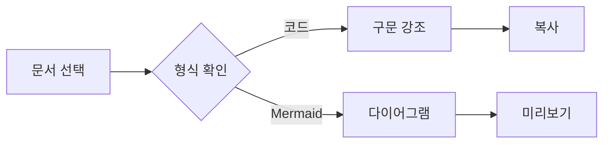
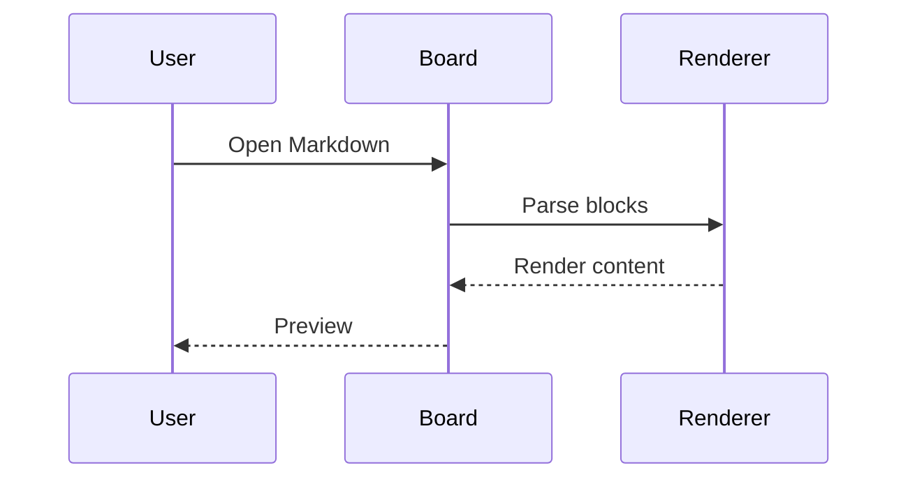
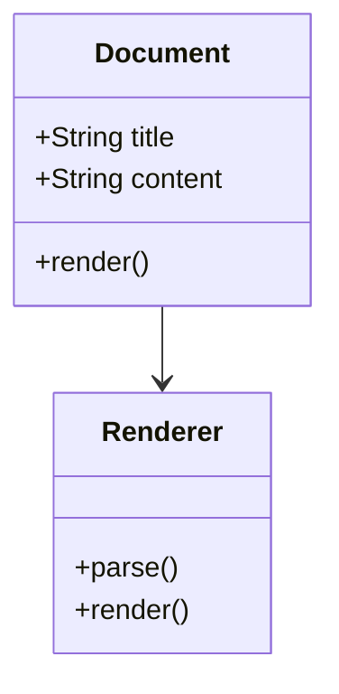
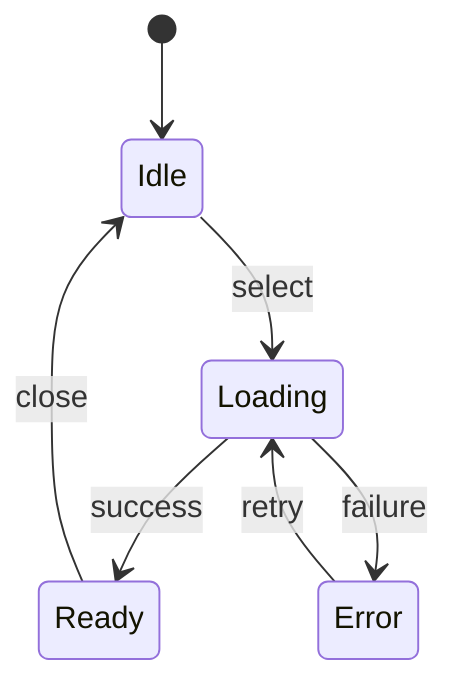
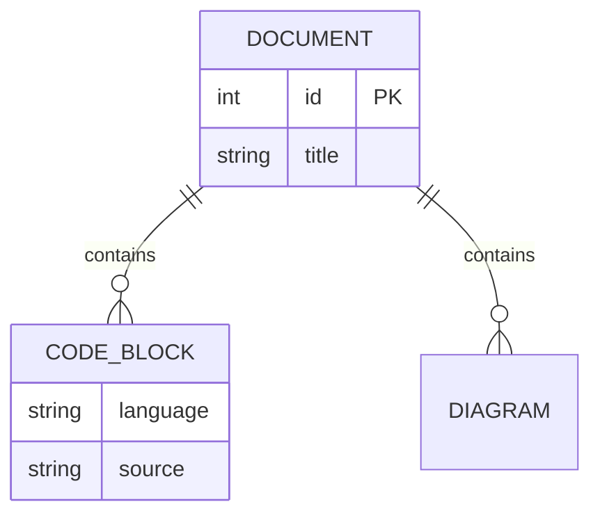
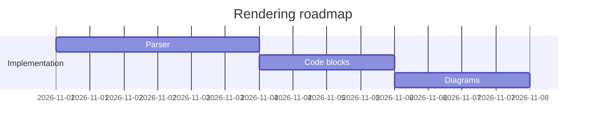
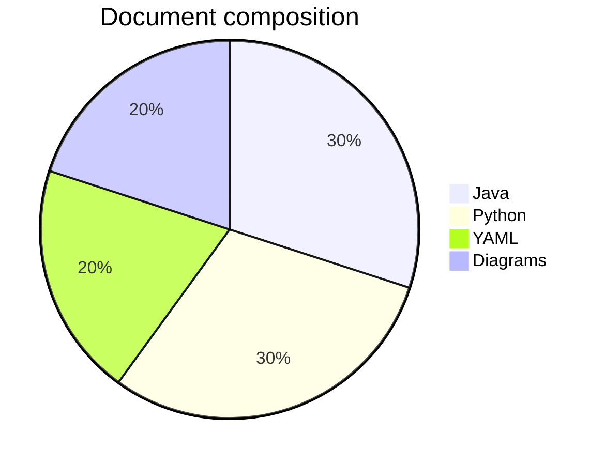
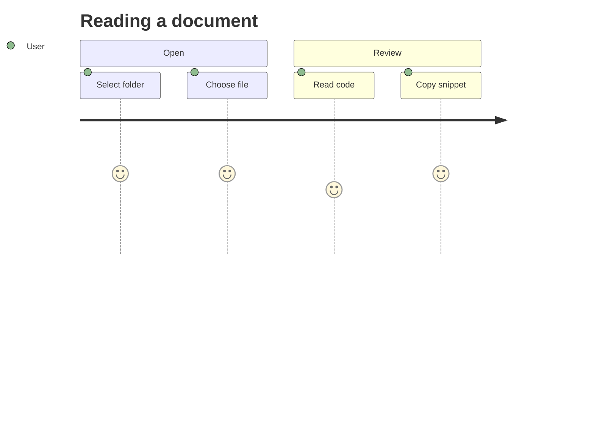

# KJA_BOARD 통합 테스트 문서

Java · Python · YAML 코드, 다양한 Mermaid 다이어그램, 표와 목록을 함께 검증하는 기본 예시입니다.
각 코드 블록의 복사 버튼과 텍스트 / 렌더 모드 전환을 확인하세요.

| 검증 항목 | 기대 동작 |
| --- | --- |
| 코드 | 구문 강조 및 원문 복사 |
| Mermaid | 여러 다이어그램을 순서대로 표시 |
| 프론트메터 | 접기 영역에 메타데이터 표시 |

## 01. 서비스 구성과 렌더링 시나리오

문서 1의 코드는 독립적인 예시입니다. 한글, 영문, 특수문자와 들여쓰기가 유지되는지 확인합니다.
**확인 순서:** 텍스트 모드에서 원문 확인 → 렌더 모드 전환 → 코드 복사 → 다이어그램 확인.

### Java 서비스

```java
package example.board;

import java.util.List;
import java.util.Optional;

public final class DocumentService1 {
    public record Document(long id, String title, String body) {}
    private final List<Document> documents;

    public DocumentService1(List<Document> documents) {
        this.documents = List.copyOf(documents);
    }

    public Optional<Document> findById(long id) {
        return documents.stream()
            .filter(document -> document.id() == id)
            .findFirst();
    }

    public List<String> titles() {
        return documents.stream().map(Document::title).sorted().toList();
    }
}
```

### Python 처리

```python
from dataclasses import dataclass
from pathlib import Path


@dataclass(frozen=True)
class Document:
    title: str
    content: str


def load_documents(root: Path) -> list[Document]:
    documents = []
    for path in sorted(root.rglob("*.md")):
        try:
            content = path.read_text(encoding="utf-8-sig")
        except (OSError, UnicodeDecodeError) as error:
            print(f"읽기 실패: {path}: {error}")
            continue
        documents.append(Document(path.stem, content))
    return documents


if __name__ == "__main__":
    for document in load_documents(Path("examples")):
        print(document.title, len(document.content))
```

### YAML 설정

```yaml
workspace:
  name: "KJA_BOARD"
  scenario: 1
  encoding: utf-8
  renderer:
    mermaid:
      enabled: true
      theme: forest
    code:
      copy_button: true
      languages:
        - java
        - python
        - yaml
  metadata:
    owner: "테스트 사용자"
    description: |
      여러 줄 문자열과 한글을 표시합니다.
      들여쓰기와 줄바꿈을 함께 확인하세요.
```

### Mermaid · flowchart



---

## 02. 서비스 구성과 렌더링 시나리오

문서 2의 코드는 독립적인 예시입니다. 한글, 영문, 특수문자와 들여쓰기가 유지되는지 확인합니다.
**확인 순서:** 텍스트 모드에서 원문 확인 → 렌더 모드 전환 → 코드 복사 → 다이어그램 확인.

### Java 서비스

```java
package example.board;

import java.util.List;
import java.util.Optional;

public final class DocumentService2 {
    public record Document(long id, String title, String body) {}
    private final List<Document> documents;

    public DocumentService2(List<Document> documents) {
        this.documents = List.copyOf(documents);
    }

    public Optional<Document> findById(long id) {
        return documents.stream()
            .filter(document -> document.id() == id)
            .findFirst();
    }

    public List<String> titles() {
        return documents.stream().map(Document::title).sorted().toList();
    }
}
```

### Python 처리

```python
from dataclasses import dataclass
from pathlib import Path


@dataclass(frozen=True)
class Document:
    title: str
    content: str


def load_documents(root: Path) -> list[Document]:
    documents = []
    for path in sorted(root.rglob("*.md")):
        try:
            content = path.read_text(encoding="utf-8-sig")
        except (OSError, UnicodeDecodeError) as error:
            print(f"읽기 실패: {path}: {error}")
            continue
        documents.append(Document(path.stem, content))
    return documents


if __name__ == "__main__":
    for document in load_documents(Path("examples")):
        print(document.title, len(document.content))
```

### YAML 설정

```yaml
workspace:
  name: "KJA_BOARD"
  scenario: 2
  encoding: utf-8
  renderer:
    mermaid:
      enabled: true
      theme: forest
    code:
      copy_button: true
      languages:
        - java
        - python
        - yaml
  metadata:
    owner: "테스트 사용자"
    description: |
      여러 줄 문자열과 한글을 표시합니다.
      들여쓰기와 줄바꿈을 함께 확인하세요.
```

### Mermaid · sequence



---

## 03. 서비스 구성과 렌더링 시나리오

문서 3의 코드는 독립적인 예시입니다. 한글, 영문, 특수문자와 들여쓰기가 유지되는지 확인합니다.
**확인 순서:** 텍스트 모드에서 원문 확인 → 렌더 모드 전환 → 코드 복사 → 다이어그램 확인.

### Java 서비스

```java
package example.board;

import java.util.List;
import java.util.Optional;

public final class DocumentService3 {
    public record Document(long id, String title, String body) {}
    private final List<Document> documents;

    public DocumentService3(List<Document> documents) {
        this.documents = List.copyOf(documents);
    }

    public Optional<Document> findById(long id) {
        return documents.stream()
            .filter(document -> document.id() == id)
            .findFirst();
    }

    public List<String> titles() {
        return documents.stream().map(Document::title).sorted().toList();
    }
}
```

### Python 처리

```python
from dataclasses import dataclass
from pathlib import Path


@dataclass(frozen=True)
class Document:
    title: str
    content: str


def load_documents(root: Path) -> list[Document]:
    documents = []
    for path in sorted(root.rglob("*.md")):
        try:
            content = path.read_text(encoding="utf-8-sig")
        except (OSError, UnicodeDecodeError) as error:
            print(f"읽기 실패: {path}: {error}")
            continue
        documents.append(Document(path.stem, content))
    return documents


if __name__ == "__main__":
    for document in load_documents(Path("examples")):
        print(document.title, len(document.content))
```

### YAML 설정

```yaml
workspace:
  name: "KJA_BOARD"
  scenario: 3
  encoding: utf-8
  renderer:
    mermaid:
      enabled: true
      theme: forest
    code:
      copy_button: true
      languages:
        - java
        - python
        - yaml
  metadata:
    owner: "테스트 사용자"
    description: |
      여러 줄 문자열과 한글을 표시합니다.
      들여쓰기와 줄바꿈을 함께 확인하세요.
```

### Mermaid · class



---

## 04. 서비스 구성과 렌더링 시나리오

문서 4의 코드는 독립적인 예시입니다. 한글, 영문, 특수문자와 들여쓰기가 유지되는지 확인합니다.
**확인 순서:** 텍스트 모드에서 원문 확인 → 렌더 모드 전환 → 코드 복사 → 다이어그램 확인.

### Java 서비스

```java
package example.board;

import java.util.List;
import java.util.Optional;

public final class DocumentService4 {
    public record Document(long id, String title, String body) {}
    private final List<Document> documents;

    public DocumentService4(List<Document> documents) {
        this.documents = List.copyOf(documents);
    }

    public Optional<Document> findById(long id) {
        return documents.stream()
            .filter(document -> document.id() == id)
            .findFirst();
    }

    public List<String> titles() {
        return documents.stream().map(Document::title).sorted().toList();
    }
}
```

### Python 처리

```python
from dataclasses import dataclass
from pathlib import Path


@dataclass(frozen=True)
class Document:
    title: str
    content: str


def load_documents(root: Path) -> list[Document]:
    documents = []
    for path in sorted(root.rglob("*.md")):
        try:
            content = path.read_text(encoding="utf-8-sig")
        except (OSError, UnicodeDecodeError) as error:
            print(f"읽기 실패: {path}: {error}")
            continue
        documents.append(Document(path.stem, content))
    return documents


if __name__ == "__main__":
    for document in load_documents(Path("examples")):
        print(document.title, len(document.content))
```

### YAML 설정

```yaml
workspace:
  name: "KJA_BOARD"
  scenario: 4
  encoding: utf-8
  renderer:
    mermaid:
      enabled: true
      theme: forest
    code:
      copy_button: true
      languages:
        - java
        - python
        - yaml
  metadata:
    owner: "테스트 사용자"
    description: |
      여러 줄 문자열과 한글을 표시합니다.
      들여쓰기와 줄바꿈을 함께 확인하세요.
```

### Mermaid · state



---

## 05. 서비스 구성과 렌더링 시나리오

문서 5의 코드는 독립적인 예시입니다. 한글, 영문, 특수문자와 들여쓰기가 유지되는지 확인합니다.
**확인 순서:** 텍스트 모드에서 원문 확인 → 렌더 모드 전환 → 코드 복사 → 다이어그램 확인.

### Java 서비스

```java
package example.board;

import java.util.List;
import java.util.Optional;

public final class DocumentService5 {
    public record Document(long id, String title, String body) {}
    private final List<Document> documents;

    public DocumentService5(List<Document> documents) {
        this.documents = List.copyOf(documents);
    }

    public Optional<Document> findById(long id) {
        return documents.stream()
            .filter(document -> document.id() == id)
            .findFirst();
    }

    public List<String> titles() {
        return documents.stream().map(Document::title).sorted().toList();
    }
}
```

### Python 처리

```python
from dataclasses import dataclass
from pathlib import Path


@dataclass(frozen=True)
class Document:
    title: str
    content: str


def load_documents(root: Path) -> list[Document]:
    documents = []
    for path in sorted(root.rglob("*.md")):
        try:
            content = path.read_text(encoding="utf-8-sig")
        except (OSError, UnicodeDecodeError) as error:
            print(f"읽기 실패: {path}: {error}")
            continue
        documents.append(Document(path.stem, content))
    return documents


if __name__ == "__main__":
    for document in load_documents(Path("examples")):
        print(document.title, len(document.content))
```

### YAML 설정

```yaml
workspace:
  name: "KJA_BOARD"
  scenario: 5
  encoding: utf-8
  renderer:
    mermaid:
      enabled: true
      theme: forest
    code:
      copy_button: true
      languages:
        - java
        - python
        - yaml
  metadata:
    owner: "테스트 사용자"
    description: |
      여러 줄 문자열과 한글을 표시합니다.
      들여쓰기와 줄바꿈을 함께 확인하세요.
```

### Mermaid · entity



---

## 06. 서비스 구성과 렌더링 시나리오

문서 6의 코드는 독립적인 예시입니다. 한글, 영문, 특수문자와 들여쓰기가 유지되는지 확인합니다.
**확인 순서:** 텍스트 모드에서 원문 확인 → 렌더 모드 전환 → 코드 복사 → 다이어그램 확인.

### Java 서비스

```java
package example.board;

import java.util.List;
import java.util.Optional;

public final class DocumentService6 {
    public record Document(long id, String title, String body) {}
    private final List<Document> documents;

    public DocumentService6(List<Document> documents) {
        this.documents = List.copyOf(documents);
    }

    public Optional<Document> findById(long id) {
        return documents.stream()
            .filter(document -> document.id() == id)
            .findFirst();
    }

    public List<String> titles() {
        return documents.stream().map(Document::title).sorted().toList();
    }
}
```

### Python 처리

```python
from dataclasses import dataclass
from pathlib import Path


@dataclass(frozen=True)
class Document:
    title: str
    content: str


def load_documents(root: Path) -> list[Document]:
    documents = []
    for path in sorted(root.rglob("*.md")):
        try:
            content = path.read_text(encoding="utf-8-sig")
        except (OSError, UnicodeDecodeError) as error:
            print(f"읽기 실패: {path}: {error}")
            continue
        documents.append(Document(path.stem, content))
    return documents


if __name__ == "__main__":
    for document in load_documents(Path("examples")):
        print(document.title, len(document.content))
```

### YAML 설정

```yaml
workspace:
  name: "KJA_BOARD"
  scenario: 6
  encoding: utf-8
  renderer:
    mermaid:
      enabled: true
      theme: forest
    code:
      copy_button: true
      languages:
        - java
        - python
        - yaml
  metadata:
    owner: "테스트 사용자"
    description: |
      여러 줄 문자열과 한글을 표시합니다.
      들여쓰기와 줄바꿈을 함께 확인하세요.
```

### Mermaid · gantt



---

## 07. 서비스 구성과 렌더링 시나리오

문서 7의 코드는 독립적인 예시입니다. 한글, 영문, 특수문자와 들여쓰기가 유지되는지 확인합니다.
**확인 순서:** 텍스트 모드에서 원문 확인 → 렌더 모드 전환 → 코드 복사 → 다이어그램 확인.

### Java 서비스

```java
package example.board;

import java.util.List;
import java.util.Optional;

public final class DocumentService7 {
    public record Document(long id, String title, String body) {}
    private final List<Document> documents;

    public DocumentService7(List<Document> documents) {
        this.documents = List.copyOf(documents);
    }

    public Optional<Document> findById(long id) {
        return documents.stream()
            .filter(document -> document.id() == id)
            .findFirst();
    }

    public List<String> titles() {
        return documents.stream().map(Document::title).sorted().toList();
    }
}
```

### Python 처리

```python
from dataclasses import dataclass
from pathlib import Path


@dataclass(frozen=True)
class Document:
    title: str
    content: str


def load_documents(root: Path) -> list[Document]:
    documents = []
    for path in sorted(root.rglob("*.md")):
        try:
            content = path.read_text(encoding="utf-8-sig")
        except (OSError, UnicodeDecodeError) as error:
            print(f"읽기 실패: {path}: {error}")
            continue
        documents.append(Document(path.stem, content))
    return documents


if __name__ == "__main__":
    for document in load_documents(Path("examples")):
        print(document.title, len(document.content))
```

### YAML 설정

```yaml
workspace:
  name: "KJA_BOARD"
  scenario: 7
  encoding: utf-8
  renderer:
    mermaid:
      enabled: true
      theme: forest
    code:
      copy_button: true
      languages:
        - java
        - python
        - yaml
  metadata:
    owner: "테스트 사용자"
    description: |
      여러 줄 문자열과 한글을 표시합니다.
      들여쓰기와 줄바꿈을 함께 확인하세요.
```

### Mermaid · pie



---

## 08. 서비스 구성과 렌더링 시나리오

문서 8의 코드는 독립적인 예시입니다. 한글, 영문, 특수문자와 들여쓰기가 유지되는지 확인합니다.
**확인 순서:** 텍스트 모드에서 원문 확인 → 렌더 모드 전환 → 코드 복사 → 다이어그램 확인.

### Java 서비스

```java
package example.board;

import java.util.List;
import java.util.Optional;

public final class DocumentService8 {
    public record Document(long id, String title, String body) {}
    private final List<Document> documents;

    public DocumentService8(List<Document> documents) {
        this.documents = List.copyOf(documents);
    }

    public Optional<Document> findById(long id) {
        return documents.stream()
            .filter(document -> document.id() == id)
            .findFirst();
    }

    public List<String> titles() {
        return documents.stream().map(Document::title).sorted().toList();
    }
}
```

### Python 처리

```python
from dataclasses import dataclass
from pathlib import Path


@dataclass(frozen=True)
class Document:
    title: str
    content: str


def load_documents(root: Path) -> list[Document]:
    documents = []
    for path in sorted(root.rglob("*.md")):
        try:
            content = path.read_text(encoding="utf-8-sig")
        except (OSError, UnicodeDecodeError) as error:
            print(f"읽기 실패: {path}: {error}")
            continue
        documents.append(Document(path.stem, content))
    return documents


if __name__ == "__main__":
    for document in load_documents(Path("examples")):
        print(document.title, len(document.content))
```

### YAML 설정

```yaml
workspace:
  name: "KJA_BOARD"
  scenario: 8
  encoding: utf-8
  renderer:
    mermaid:
      enabled: true
      theme: forest
    code:
      copy_button: true
      languages:
        - java
        - python
        - yaml
  metadata:
    owner: "테스트 사용자"
    description: |
      여러 줄 문자열과 한글을 표시합니다.
      들여쓰기와 줄바꿈을 함께 확인하세요.
```

### Mermaid · journey



---

## 09. 서비스 구성과 렌더링 시나리오

문서 9의 코드는 독립적인 예시입니다. 한글, 영문, 특수문자와 들여쓰기가 유지되는지 확인합니다.
**확인 순서:** 텍스트 모드에서 원문 확인 → 렌더 모드 전환 → 코드 복사 → 다이어그램 확인.

### Java 서비스

```java
package example.board;

import java.util.List;
import java.util.Optional;

public final class DocumentService9 {
    public record Document(long id, String title, String body) {}
    private final List<Document> documents;

    public DocumentService9(List<Document> documents) {
        this.documents = List.copyOf(documents);
    }

    public Optional<Document> findById(long id) {
        return documents.stream()
            .filter(document -> document.id() == id)
            .findFirst();
    }

    public List<String> titles() {
        return documents.stream().map(Document::title).sorted().toList();
    }
}
```

### Python 처리

```python
from dataclasses import dataclass
from pathlib import Path


@dataclass(frozen=True)
class Document:
    title: str
    content: str


def load_documents(root: Path) -> list[Document]:
    documents = []
    for path in sorted(root.rglob("*.md")):
        try:
            content = path.read_text(encoding="utf-8-sig")
        except (OSError, UnicodeDecodeError) as error:
            print(f"읽기 실패: {path}: {error}")
            continue
        documents.append(Document(path.stem, content))
    return documents


if __name__ == "__main__":
    for document in load_documents(Path("examples")):
        print(document.title, len(document.content))
```

### YAML 설정

```yaml
workspace:
  name: "KJA_BOARD"
  scenario: 9
  encoding: utf-8
  renderer:
    mermaid:
      enabled: true
      theme: forest
    code:
      copy_button: true
      languages:
        - java
        - python
        - yaml
  metadata:
    owner: "테스트 사용자"
    description: |
      여러 줄 문자열과 한글을 표시합니다.
      들여쓰기와 줄바꿈을 함께 확인하세요.
```

### Mermaid · flowchart


---

## 10. 서비스 구성과 렌더링 시나리오

문서 10의 코드는 독립적인 예시입니다. 한글, 영문, 특수문자와 들여쓰기가 유지되는지 확인합니다.
**확인 순서:** 텍스트 모드에서 원문 확인 → 렌더 모드 전환 → 코드 복사 → 다이어그램 확인.

### Java 서비스

```java
package example.board;

import java.util.List;
import java.util.Optional;

public final class DocumentService10 {
    public record Document(long id, String title, String body) {}
    private final List<Document> documents;

    public DocumentService10(List<Document> documents) {
        this.documents = List.copyOf(documents);
    }

    public Optional<Document> findById(long id) {
        return documents.stream()
            .filter(document -> document.id() == id)
            .findFirst();
    }

    public List<String> titles() {
        return documents.stream().map(Document::title).sorted().toList();
    }
}
```

### Python 처리

```python
from dataclasses import dataclass
from pathlib import Path


@dataclass(frozen=True)
class Document:
    title: str
    content: str


def load_documents(root: Path) -> list[Document]:
    documents = []
    for path in sorted(root.rglob("*.md")):
        try:
            content = path.read_text(encoding="utf-8-sig")
        except (OSError, UnicodeDecodeError) as error:
            print(f"읽기 실패: {path}: {error}")
            continue
        documents.append(Document(path.stem, content))
    return documents


if __name__ == "__main__":
    for document in load_documents(Path("examples")):
        print(document.title, len(document.content))
```

### YAML 설정

```yaml
workspace:
  name: "KJA_BOARD"
  scenario: 10
  encoding: utf-8
  renderer:
    mermaid:
      enabled: true
      theme: forest
    code:
      copy_button: true
      languages:
        - java
        - python
        - yaml
  metadata:
    owner: "테스트 사용자"
    description: |
      여러 줄 문자열과 한글을 표시합니다.
      들여쓰기와 줄바꿈을 함께 확인하세요.
```

### Mermaid · sequence


---

## 11. 서비스 구성과 렌더링 시나리오

문서 11의 코드는 독립적인 예시입니다. 한글, 영문, 특수문자와 들여쓰기가 유지되는지 확인합니다.
**확인 순서:** 텍스트 모드에서 원문 확인 → 렌더 모드 전환 → 코드 복사 → 다이어그램 확인.

### Java 서비스

```java
package example.board;

import java.util.List;
import java.util.Optional;

public final class DocumentService11 {
    public record Document(long id, String title, String body) {}
    private final List<Document> documents;

    public DocumentService11(List<Document> documents) {
        this.documents = List.copyOf(documents);
    }

    public Optional<Document> findById(long id) {
        return documents.stream()
            .filter(document -> document.id() == id)
            .findFirst();
    }

    public List<String> titles() {
        return documents.stream().map(Document::title).sorted().toList();
    }
}
```

### Python 처리

```python
from dataclasses import dataclass
from pathlib import Path


@dataclass(frozen=True)
class Document:
    title: str
    content: str


def load_documents(root: Path) -> list[Document]:
    documents = []
    for path in sorted(root.rglob("*.md")):
        try:
            content = path.read_text(encoding="utf-8-sig")
        except (OSError, UnicodeDecodeError) as error:
            print(f"읽기 실패: {path}: {error}")
            continue
        documents.append(Document(path.stem, content))
    return documents


if __name__ == "__main__":
    for document in load_documents(Path("examples")):
        print(document.title, len(document.content))
```

### YAML 설정

```yaml
workspace:
  name: "KJA_BOARD"
  scenario: 11
  encoding: utf-8
  renderer:
    mermaid:
      enabled: true
      theme: forest
    code:
      copy_button: true
      languages:
        - java
        - python
        - yaml
  metadata:
    owner: "테스트 사용자"
    description: |
      여러 줄 문자열과 한글을 표시합니다.
      들여쓰기와 줄바꿈을 함께 확인하세요.
```

### Mermaid · class


---

## 12. 서비스 구성과 렌더링 시나리오

문서 12의 코드는 독립적인 예시입니다. 한글, 영문, 특수문자와 들여쓰기가 유지되는지 확인합니다.
**확인 순서:** 텍스트 모드에서 원문 확인 → 렌더 모드 전환 → 코드 복사 → 다이어그램 확인.

### Java 서비스

```java
package example.board;

import java.util.List;
import java.util.Optional;

public final class DocumentService12 {
    public record Document(long id, String title, String body) {}
    private final List<Document> documents;

    public DocumentService12(List<Document> documents) {
        this.documents = List.copyOf(documents);
    }

    public Optional<Document> findById(long id) {
        return documents.stream()
            .filter(document -> document.id() == id)
            .findFirst();
    }

    public List<String> titles() {
        return documents.stream().map(Document::title).sorted().toList();
    }
}
```

### Python 처리

```python
from dataclasses import dataclass
from pathlib import Path


@dataclass(frozen=True)
class Document:
    title: str
    content: str


def load_documents(root: Path) -> list[Document]:
    documents = []
    for path in sorted(root.rglob("*.md")):
        try:
            content = path.read_text(encoding="utf-8-sig")
        except (OSError, UnicodeDecodeError) as error:
            print(f"읽기 실패: {path}: {error}")
            continue
        documents.append(Document(path.stem, content))
    return documents


if __name__ == "__main__":
    for document in load_documents(Path("examples")):
        print(document.title, len(document.content))
```

### YAML 설정

```yaml
workspace:
  name: "KJA_BOARD"
  scenario: 12
  encoding: utf-8
  renderer:
    mermaid:
      enabled: true
      theme: forest
    code:
      copy_button: true
      languages:
        - java
        - python
        - yaml
  metadata:
    owner: "테스트 사용자"
    description: |
      여러 줄 문자열과 한글을 표시합니다.
      들여쓰기와 줄바꿈을 함께 확인하세요.
```

### Mermaid · state


---

## 13. 서비스 구성과 렌더링 시나리오

문서 13의 코드는 독립적인 예시입니다. 한글, 영문, 특수문자와 들여쓰기가 유지되는지 확인합니다.
**확인 순서:** 텍스트 모드에서 원문 확인 → 렌더 모드 전환 → 코드 복사 → 다이어그램 확인.

### Java 서비스

```java
package example.board;

import java.util.List;
import java.util.Optional;

public final class DocumentService13 {
    public record Document(long id, String title, String body) {}
    private final List<Document> documents;

    public DocumentService13(List<Document> documents) {
        this.documents = List.copyOf(documents);
    }

    public Optional<Document> findById(long id) {
        return documents.stream()
            .filter(document -> document.id() == id)
            .findFirst();
    }

    public List<String> titles() {
        return documents.stream().map(Document::title).sorted().toList();
    }
}
```

### Python 처리

```python
from dataclasses import dataclass
from pathlib import Path


@dataclass(frozen=True)
class Document:
    title: str
    content: str


def load_documents(root: Path) -> list[Document]:
    documents = []
    for path in sorted(root.rglob("*.md")):
        try:
            content = path.read_text(encoding="utf-8-sig")
        except (OSError, UnicodeDecodeError) as error:
            print(f"읽기 실패: {path}: {error}")
            continue
        documents.append(Document(path.stem, content))
    return documents


if __name__ == "__main__":
    for document in load_documents(Path("examples")):
        print(document.title, len(document.content))
```

### YAML 설정

```yaml
workspace:
  name: "KJA_BOARD"
  scenario: 13
  encoding: utf-8
  renderer:
    mermaid:
      enabled: true
      theme: forest
    code:
      copy_button: true
      languages:
        - java
        - python
        - yaml
  metadata:
    owner: "테스트 사용자"
    description: |
      여러 줄 문자열과 한글을 표시합니다.
      들여쓰기와 줄바꿈을 함께 확인하세요.
```

### Mermaid · entity


---

## 14. 서비스 구성과 렌더링 시나리오

문서 14의 코드는 독립적인 예시입니다. 한글, 영문, 특수문자와 들여쓰기가 유지되는지 확인합니다.
**확인 순서:** 텍스트 모드에서 원문 확인 → 렌더 모드 전환 → 코드 복사 → 다이어그램 확인.

### Java 서비스

```java
package example.board;

import java.util.List;
import java.util.Optional;

public final class DocumentService14 {
    public record Document(long id, String title, String body) {}
    private final List<Document> documents;

    public DocumentService14(List<Document> documents) {
        this.documents = List.copyOf(documents);
    }

    public Optional<Document> findById(long id) {
        return documents.stream()
            .filter(document -> document.id() == id)
            .findFirst();
    }

    public List<String> titles() {
        return documents.stream().map(Document::title).sorted().toList();
    }
}
```

### Python 처리

```python
from dataclasses import dataclass
from pathlib import Path


@dataclass(frozen=True)
class Document:
    title: str
    content: str


def load_documents(root: Path) -> list[Document]:
    documents = []
    for path in sorted(root.rglob("*.md")):
        try:
            content = path.read_text(encoding="utf-8-sig")
        except (OSError, UnicodeDecodeError) as error:
            print(f"읽기 실패: {path}: {error}")
            continue
        documents.append(Document(path.stem, content))
    return documents


if __name__ == "__main__":
    for document in load_documents(Path("examples")):
        print(document.title, len(document.content))
```

### YAML 설정

```yaml
workspace:
  name: "KJA_BOARD"
  scenario: 14
  encoding: utf-8
  renderer:
    mermaid:
      enabled: true
      theme: forest
    code:
      copy_button: true
      languages:
        - java
        - python
        - yaml
  metadata:
    owner: "테스트 사용자"
    description: |
      여러 줄 문자열과 한글을 표시합니다.
      들여쓰기와 줄바꿈을 함께 확인하세요.
```

### Mermaid · gantt


---

## 15. 서비스 구성과 렌더링 시나리오

문서 15의 코드는 독립적인 예시입니다. 한글, 영문, 특수문자와 들여쓰기가 유지되는지 확인합니다.
**확인 순서:** 텍스트 모드에서 원문 확인 → 렌더 모드 전환 → 코드 복사 → 다이어그램 확인.

### Java 서비스

```java
package example.board;

import java.util.List;
import java.util.Optional;

public final class DocumentService15 {
    public record Document(long id, String title, String body) {}
    private final List<Document> documents;

    public DocumentService15(List<Document> documents) {
        this.documents = List.copyOf(documents);
    }

    public Optional<Document> findById(long id) {
        return documents.stream()
            .filter(document -> document.id() == id)
            .findFirst();
    }

    public List<String> titles() {
        return documents.stream().map(Document::title).sorted().toList();
    }
}
```

### Python 처리

```python
from dataclasses import dataclass
from pathlib import Path


@dataclass(frozen=True)
class Document:
    title: str
    content: str


def load_documents(root: Path) -> list[Document]:
    documents = []
    for path in sorted(root.rglob("*.md")):
        try:
            content = path.read_text(encoding="utf-8-sig")
        except (OSError, UnicodeDecodeError) as error:
            print(f"읽기 실패: {path}: {error}")
            continue
        documents.append(Document(path.stem, content))
    return documents


if __name__ == "__main__":
    for document in load_documents(Path("examples")):
        print(document.title, len(document.content))
```

### YAML 설정

```yaml
workspace:
  name: "KJA_BOARD"
  scenario: 15
  encoding: utf-8
  renderer:
    mermaid:
      enabled: true
      theme: forest
    code:
      copy_button: true
      languages:
        - java
        - python
        - yaml
  metadata:
    owner: "테스트 사용자"
    description: |
      여러 줄 문자열과 한글을 표시합니다.
      들여쓰기와 줄바꿈을 함께 확인하세요.
```

### Mermaid · pie


---

## 16. 서비스 구성과 렌더링 시나리오

문서 16의 코드는 독립적인 예시입니다. 한글, 영문, 특수문자와 들여쓰기가 유지되는지 확인합니다.
**확인 순서:** 텍스트 모드에서 원문 확인 → 렌더 모드 전환 → 코드 복사 → 다이어그램 확인.

### Java 서비스

```java
package example.board;

import java.util.List;
import java.util.Optional;

public final class DocumentService16 {
    public record Document(long id, String title, String body) {}
    private final List<Document> documents;

    public DocumentService16(List<Document> documents) {
        this.documents = List.copyOf(documents);
    }

    public Optional<Document> findById(long id) {
        return documents.stream()
            .filter(document -> document.id() == id)
            .findFirst();
    }

    public List<String> titles() {
        return documents.stream().map(Document::title).sorted().toList();
    }
}
```

### Python 처리

```python
from dataclasses import dataclass
from pathlib import Path


@dataclass(frozen=True)
class Document:
    title: str
    content: str


def load_documents(root: Path) -> list[Document]:
    documents = []
    for path in sorted(root.rglob("*.md")):
        try:
            content = path.read_text(encoding="utf-8-sig")
        except (OSError, UnicodeDecodeError) as error:
            print(f"읽기 실패: {path}: {error}")
            continue
        documents.append(Document(path.stem, content))
    return documents


if __name__ == "__main__":
    for document in load_documents(Path("examples")):
        print(document.title, len(document.content))
```

### YAML 설정

```yaml
workspace:
  name: "KJA_BOARD"
  scenario: 16
  encoding: utf-8
  renderer:
    mermaid:
      enabled: true
      theme: forest
    code:
      copy_button: true
      languages:
        - java
        - python
        - yaml
  metadata:
    owner: "테스트 사용자"
    description: |
      여러 줄 문자열과 한글을 표시합니다.
      들여쓰기와 줄바꿈을 함께 확인하세요.
```

### Mermaid · journey


---

## 17. 서비스 구성과 렌더링 시나리오

문서 17의 코드는 독립적인 예시입니다. 한글, 영문, 특수문자와 들여쓰기가 유지되는지 확인합니다.
**확인 순서:** 텍스트 모드에서 원문 확인 → 렌더 모드 전환 → 코드 복사 → 다이어그램 확인.

### Java 서비스

```java
package example.board;

import java.util.List;
import java.util.Optional;

public final class DocumentService17 {
    public record Document(long id, String title, String body) {}
    private final List<Document> documents;

    public DocumentService17(List<Document> documents) {
        this.documents = List.copyOf(documents);
    }

    public Optional<Document> findById(long id) {
        return documents.stream()
            .filter(document -> document.id() == id)
            .findFirst();
    }

    public List<String> titles() {
        return documents.stream().map(Document::title).sorted().toList();
    }
}
```

### Python 처리

```python
from dataclasses import dataclass
from pathlib import Path


@dataclass(frozen=True)
class Document:
    title: str
    content: str


def load_documents(root: Path) -> list[Document]:
    documents = []
    for path in sorted(root.rglob("*.md")):
        try:
            content = path.read_text(encoding="utf-8-sig")
        except (OSError, UnicodeDecodeError) as error:
            print(f"읽기 실패: {path}: {error}")
            continue
        documents.append(Document(path.stem, content))
    return documents


if __name__ == "__main__":
    for document in load_documents(Path("examples")):
        print(document.title, len(document.content))
```

### YAML 설정

```yaml
workspace:
  name: "KJA_BOARD"
  scenario: 17
  encoding: utf-8
  renderer:
    mermaid:
      enabled: true
      theme: forest
    code:
      copy_button: true
      languages:
        - java
        - python
        - yaml
  metadata:
    owner: "테스트 사용자"
    description: |
      여러 줄 문자열과 한글을 표시합니다.
      들여쓰기와 줄바꿈을 함께 확인하세요.
```

### Mermaid · flowchart


---

## 18. 서비스 구성과 렌더링 시나리오

문서 18의 코드는 독립적인 예시입니다. 한글, 영문, 특수문자와 들여쓰기가 유지되는지 확인합니다.
**확인 순서:** 텍스트 모드에서 원문 확인 → 렌더 모드 전환 → 코드 복사 → 다이어그램 확인.

### Java 서비스

```java
package example.board;

import java.util.List;
import java.util.Optional;

public final class DocumentService18 {
    public record Document(long id, String title, String body) {}
    private final List<Document> documents;

    public DocumentService18(List<Document> documents) {
        this.documents = List.copyOf(documents);
    }

    public Optional<Document> findById(long id) {
        return documents.stream()
            .filter(document -> document.id() == id)
            .findFirst();
    }

    public List<String> titles() {
        return documents.stream().map(Document::title).sorted().toList();
    }
}
```

### Python 처리

```python
from dataclasses import dataclass
from pathlib import Path


@dataclass(frozen=True)
class Document:
    title: str
    content: str


def load_documents(root: Path) -> list[Document]:
    documents = []
    for path in sorted(root.rglob("*.md")):
        try:
            content = path.read_text(encoding="utf-8-sig")
        except (OSError, UnicodeDecodeError) as error:
            print(f"읽기 실패: {path}: {error}")
            continue
        documents.append(Document(path.stem, content))
    return documents


if __name__ == "__main__":
    for document in load_documents(Path("examples")):
        print(document.title, len(document.content))
```

### YAML 설정

```yaml
workspace:
  name: "KJA_BOARD"
  scenario: 18
  encoding: utf-8
  renderer:
    mermaid:
      enabled: true
      theme: forest
    code:
      copy_button: true
      languages:
        - java
        - python
        - yaml
  metadata:
    owner: "테스트 사용자"
    description: |
      여러 줄 문자열과 한글을 표시합니다.
      들여쓰기와 줄바꿈을 함께 확인하세요.
```

### Mermaid · sequence


---

## 19. 서비스 구성과 렌더링 시나리오

문서 19의 코드는 독립적인 예시입니다. 한글, 영문, 특수문자와 들여쓰기가 유지되는지 확인합니다.
**확인 순서:** 텍스트 모드에서 원문 확인 → 렌더 모드 전환 → 코드 복사 → 다이어그램 확인.

### Java 서비스

```java
package example.board;

import java.util.List;
import java.util.Optional;

public final class DocumentService19 {
    public record Document(long id, String title, String body) {}
    private final List<Document> documents;

    public DocumentService19(List<Document> documents) {
        this.documents = List.copyOf(documents);
    }

    public Optional<Document> findById(long id) {
        return documents.stream()
            .filter(document -> document.id() == id)
            .findFirst();
    }

    public List<String> titles() {
        return documents.stream().map(Document::title).sorted().toList();
    }
}
```

### Python 처리

```python
from dataclasses import dataclass
from pathlib import Path


@dataclass(frozen=True)
class Document:
    title: str
    content: str


def load_documents(root: Path) -> list[Document]:
    documents = []
    for path in sorted(root.rglob("*.md")):
        try:
            content = path.read_text(encoding="utf-8-sig")
        except (OSError, UnicodeDecodeError) as error:
            print(f"읽기 실패: {path}: {error}")
            continue
        documents.append(Document(path.stem, content))
    return documents


if __name__ == "__main__":
    for document in load_documents(Path("examples")):
        print(document.title, len(document.content))
```

### YAML 설정

```yaml
workspace:
  name: "KJA_BOARD"
  scenario: 19
  encoding: utf-8
  renderer:
    mermaid:
      enabled: true
      theme: forest
    code:
      copy_button: true
      languages:
        - java
        - python
        - yaml
  metadata:
    owner: "테스트 사용자"
    description: |
      여러 줄 문자열과 한글을 표시합니다.
      들여쓰기와 줄바꿈을 함께 확인하세요.
```

### Mermaid · class


---

## 20. 서비스 구성과 렌더링 시나리오

문서 20의 코드는 독립적인 예시입니다. 한글, 영문, 특수문자와 들여쓰기가 유지되는지 확인합니다.
**확인 순서:** 텍스트 모드에서 원문 확인 → 렌더 모드 전환 → 코드 복사 → 다이어그램 확인.

### Java 서비스

```java
package example.board;

import java.util.List;
import java.util.Optional;

public final class DocumentService20 {
    public record Document(long id, String title, String body) {}
    private final List<Document> documents;

    public DocumentService20(List<Document> documents) {
        this.documents = List.copyOf(documents);
    }

    public Optional<Document> findById(long id) {
        return documents.stream()
            .filter(document -> document.id() == id)
            .findFirst();
    }

    public List<String> titles() {
        return documents.stream().map(Document::title).sorted().toList();
    }
}
```

### Python 처리

```python
from dataclasses import dataclass
from pathlib import Path


@dataclass(frozen=True)
class Document:
    title: str
    content: str


def load_documents(root: Path) -> list[Document]:
    documents = []
    for path in sorted(root.rglob("*.md")):
        try:
            content = path.read_text(encoding="utf-8-sig")
        except (OSError, UnicodeDecodeError) as error:
            print(f"읽기 실패: {path}: {error}")
            continue
        documents.append(Document(path.stem, content))
    return documents


if __name__ == "__main__":
    for document in load_documents(Path("examples")):
        print(document.title, len(document.content))
```

### YAML 설정

```yaml
workspace:
  name: "KJA_BOARD"
  scenario: 20
  encoding: utf-8
  renderer:
    mermaid:
      enabled: true
      theme: forest
    code:
      copy_button: true
      languages:
        - java
        - python
        - yaml
  metadata:
    owner: "테스트 사용자"
    description: |
      여러 줄 문자열과 한글을 표시합니다.
      들여쓰기와 줄바꿈을 함께 확인하세요.
```

### Mermaid · state


---

## 21. 서비스 구성과 렌더링 시나리오

문서 21의 코드는 독립적인 예시입니다. 한글, 영문, 특수문자와 들여쓰기가 유지되는지 확인합니다.
**확인 순서:** 텍스트 모드에서 원문 확인 → 렌더 모드 전환 → 코드 복사 → 다이어그램 확인.

### Java 서비스

```java
package example.board;

import java.util.List;
import java.util.Optional;

public final class DocumentService21 {
    public record Document(long id, String title, String body) {}
    private final List<Document> documents;

    public DocumentService21(List<Document> documents) {
        this.documents = List.copyOf(documents);
    }

    public Optional<Document> findById(long id) {
        return documents.stream()
            .filter(document -> document.id() == id)
            .findFirst();
    }

    public List<String> titles() {
        return documents.stream().map(Document::title).sorted().toList();
    }
}
```

### Python 처리

```python
from dataclasses import dataclass
from pathlib import Path


@dataclass(frozen=True)
class Document:
    title: str
    content: str


def load_documents(root: Path) -> list[Document]:
    documents = []
    for path in sorted(root.rglob("*.md")):
        try:
            content = path.read_text(encoding="utf-8-sig")
        except (OSError, UnicodeDecodeError) as error:
            print(f"읽기 실패: {path}: {error}")
            continue
        documents.append(Document(path.stem, content))
    return documents


if __name__ == "__main__":
    for document in load_documents(Path("examples")):
        print(document.title, len(document.content))
```

### YAML 설정

```yaml
workspace:
  name: "KJA_BOARD"
  scenario: 21
  encoding: utf-8
  renderer:
    mermaid:
      enabled: true
      theme: forest
    code:
      copy_button: true
      languages:
        - java
        - python
        - yaml
  metadata:
    owner: "테스트 사용자"
    description: |
      여러 줄 문자열과 한글을 표시합니다.
      들여쓰기와 줄바꿈을 함께 확인하세요.
```

### Mermaid · entity

```mermaid
erDiagram
    DOCUMENT ||--o{ CODE_BLOCK : contains
    DOCUMENT ||--o{ DIAGRAM : contains
    DOCUMENT {
        int id PK
        string title
    }
    CODE_BLOCK {
        string language
        string source
    }
```

---


<!-- xxxxxxxxxxxxxxxxxxxxxxxxxxxxxxxxxxxxxxxxxxxxxxxxxxxxxxxxxxxxxxxxxxxxxxxxxxxxxxxxxxxxxxxxxxxxxxxxxxxxxxxxxxxxxxxxxxxxxxxxxxxxxxxxxxxxxxxxxxxxxxxxxxxxxxxxxxxxxxxxxxxxxxxxxxxxxxxxxxxxxxxxxxxxxxxxxxxxxxxxxxxxxxxxxxxxxxxxxxxxxxxxxxxxxxxxxxxxxxxxxxxxxxxxxxxxxxxxxxxxxxxxxxxxxxxxxxxxxxxxxxxxxxxxxxxxxxxxxxxxxxxxxxxxxxxxxxxxxxxxxxxxxxxxxxxxxxxxxxxxxxxxxxxxxxxxxxxxxxxxxxxxxxxxxxxxxxxxxxxxxxxxxxxxxxxxxxxxxxxxxxxxxxxxxxxxxxxxxxxxxxxxxxxxxxxxxxxxxxxxxxxxxxxxxxxxxxxxxxxxxxxxxxxxxxxxxxxxxxxxxxxxxxxxxxxxxxxxxxxxxxxxxxxxxxxxxxxxxxxxxxxxxxxxxxxxxxxxxxxxxxxxxxxxxxxxxxxxxxxxxxxxxxxxxxxxxxxxxxxxxxxxxxxxxxxxxxxxxxxxxxxxxxxxxxxxxxxxxxxxxxxxxxxxxxxxxxxxxxxxxxxxxxxxxxxxxxxxxxxxxxxxxxxxxxxxxxxxxxxxxxxxxxxxxxxxxxxxxxxxxxxxxxxxxxxxxxxxxxxxxxxxxxxxxxxxxxxxxxxxxxxxxxxxxxxxxxxxxxxxxxxxxxxxxxxxxxxxxxxxxxxxxxxxxxxxxxxxxxxxxxxxxxxxxxxxxxxxxxxxxxxxxxxxxxxxxxxxxxxxxxxxxxxxxxxxxxxxxxxxxxxxxxxxxxxxxxxxxxxxxxxxxxxxxxxxxxxxxxxxxxxxxxxxxxxxxxxxxxxxxxxxxxxxxxxxxxxxxxxxxxxxxxxxxxxxxxxxxxxxxxxxxxxxxxxxxxxxxxxxxxxxxxxxxxxxxxxxxxxxxxxxxxxxxxxxxxxxxxxxxxxxxxxxxxxxxxxxxxxxxxxxxxxxxxxxxxxxxxxxxxxxxxxxxxxxxxxxxxxxxxxxxxxxxxxxxxxxxxxxxxxxxxxxxxxxxxxxxxxxxxxxxxxxxxxxxxxxxxxxxxxxxxxxxxxxxxxxxxxxxxxxxxxxxxxxxxxxxxxxxxxxxxxxxxxxxxxxxxxxxxxxxxxxxxxxxxxxxxxxxxxxxxxxxxxxxxxxxxxxxxxxxxxxxxxxxxxxxxxxxxxxxxxxxxxxxxxxxxxxxxxxxxxxxxxxxxxxxxxxxxxxxxxxxxxxxxxxxxxxxxxxxxxxxxxxxxxxxxxxxxxxxxxxxxxxxxxxxxxxxxxxxxxxxxxxxxxxxxxxxxxxxxxxxxxxxxxxxxxxxxxxxxxxxxxxxxxxxxxxxxxxxxxxxxxxxxxxxxxxxxxxxxxxxxxxxxxxxxxxxxxxxxxxxxxxxxxxxxxxxxxxxxxxxxxxxxxxxxxxxxxxxxxxxxxxxxxxxxxxxxxxxxxxxxxxxxxxxxxxxxxxxxxxxxxxxxxxxxxxxxxxxxxxxxxxxxxxxxxxxxxxxxxxxxxxxxxxxxxxxxxxxxxxxxxxxxxxxxxxxxxxxxxxxxxxxxxxxxxxxxxxxxxxxxxxxxxxxxxxxxxxxxxxxxxxxxxxxxxxxxxxxxxxx -->